# Endless Tower — Design Documentation

> A mindful to-do app. Tasks are stones; your day is a tower you build.

Endless Tower replaces the checkbox list with a physical metaphor: every task is an
irregular stone, stacked into a tower that grows as your day fills. Completing a task
doesn't cross it out — it fills the stone with colour, so a finished day reads as a
colourful, slightly wobbly monument to what you carried.

**Role:** Product, UX & interaction design, build · **Stack:** Next.js, TypeScript, SVG, no backend

  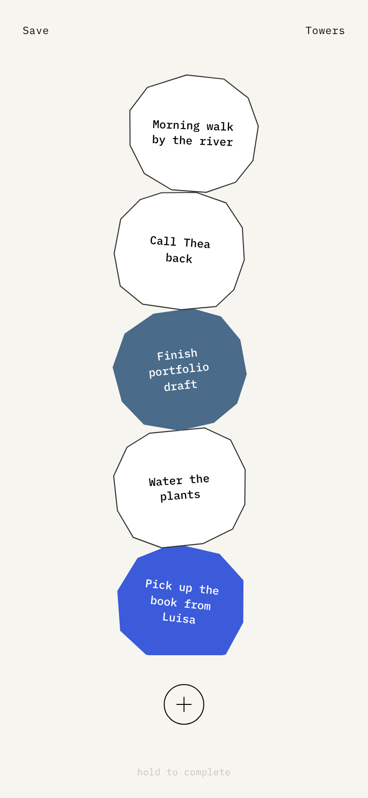

---

## Design principles

1. **Physical objects, not UI widgets.** No cards, no checkboxes, no chrome. Stones have
   silhouette, weight and imperfection; the interface around them stays almost invisible.
2. **Color is earned.** The canvas is warm paper and ink. The only colour in the app is a
   completed task — so colour literally measures progress.
3. **Slow, forgiving gestures.** Completing takes a deliberate 1.5-second hold; deleting
   hides behind a tap; everything destructive can be undone for five seconds. The app never
   punishes a stray thumb.
4. **One deterministic identity per task.** Shape, colour, rotation and offset all derive
   from a hash of the task's id. A stone looks the same forever — nothing is random at
   render time.

---

## The journey

### Arrival & first run

A quiet name reveal, then onboarding that teaches the three gestures with live demo
stones — the instructions are the product.

| Loading | Onboarding | Empty state |
|:---:|:---:|:---:|
| 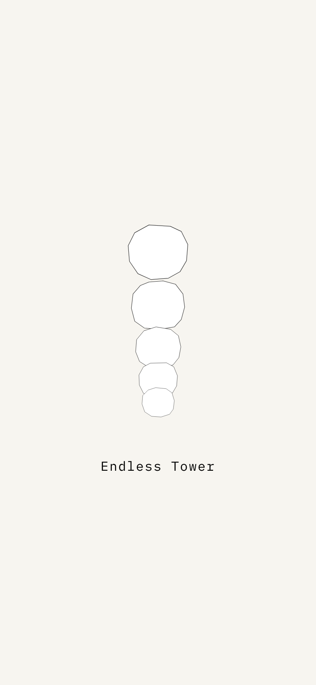 | 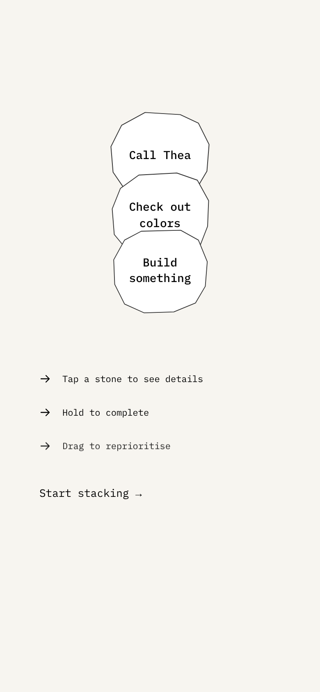 | 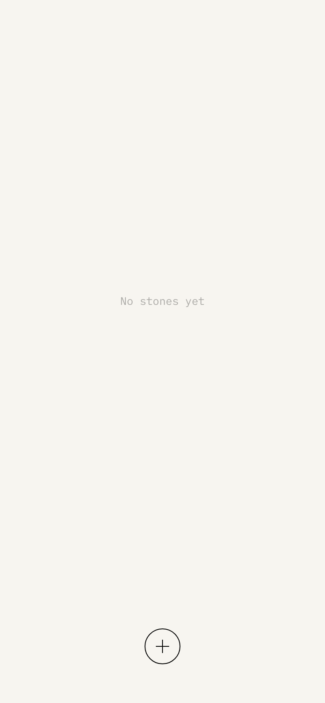 |

### Building the tower

New stones fall from above the viewport and land on top with a soft bounce
(640–800 ms, duration varied per stone). The tower is bottom-anchored: one or two
stones sit near your thumb, not stranded at the top of empty space.

| The tower | Stone detail (tap) | Edit in place (tap text) |
|:---:|:---:|:---:|
|  | 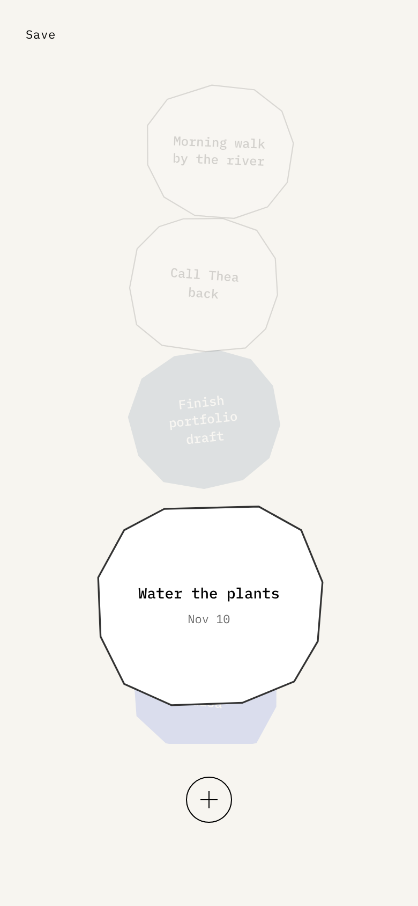 | 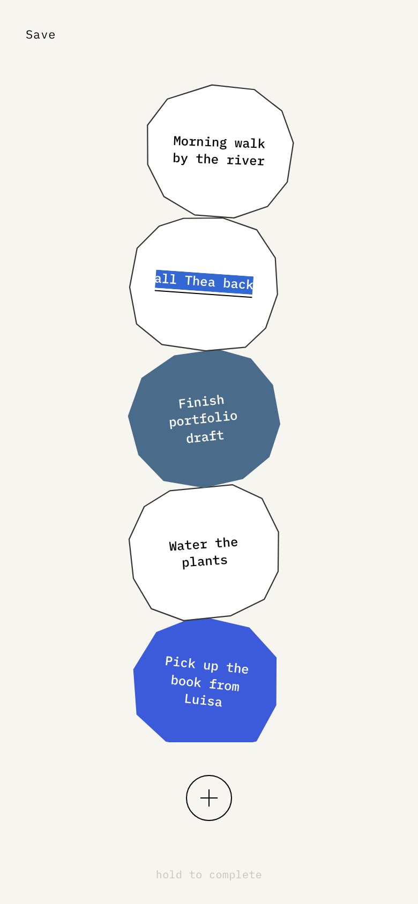 |

### Completing — the signature interaction

Hold a stone and its completion colour rises through the silhouette like water filling a
vessel. Release early and nothing happens. After it fills, a quiet `undo` offers a
five-second way back.

| Hold to complete (mid-fill) | Completed + undo |
|:---:|:---:|
| 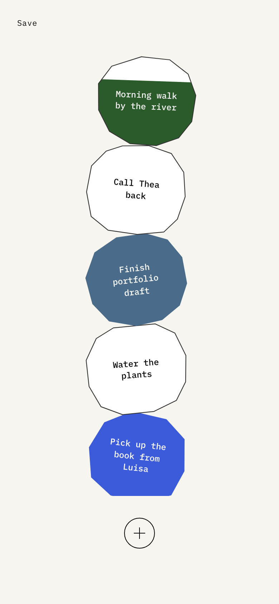 | 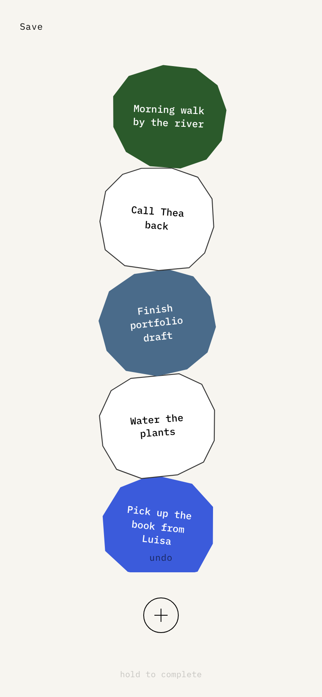 |

### Saving & remembering

A finished tower gets a name and moves to the archive, where each day renders as a
miniature of the real tower — same shapes, same colours — so the overview becomes a
shelf of small monuments.

| Save dialog | Towers archive | Tower detail |
|:---:|:---:|:---:|
| 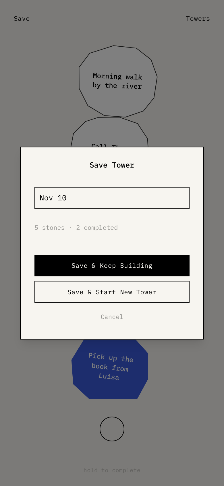 | 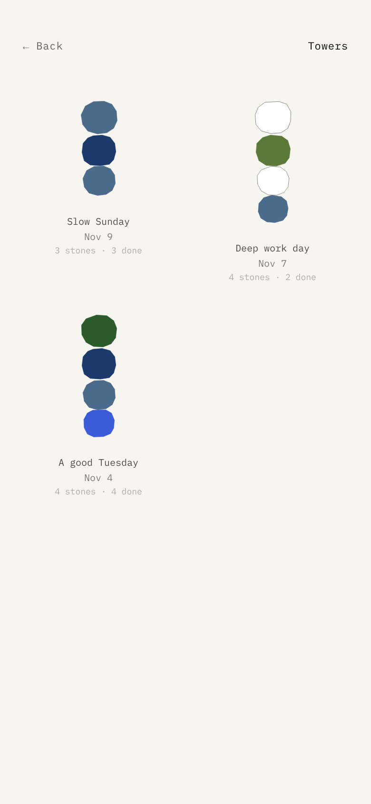 | 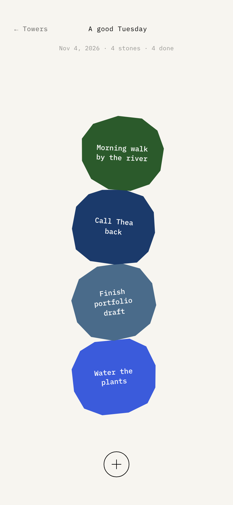 |

### Desktop

On large screens the app presents itself as an object: a phone-sized frame floating on a
matte surround.

  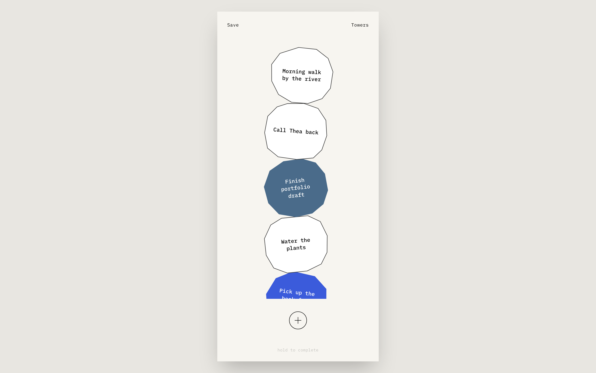

---

## Design system

### Stones

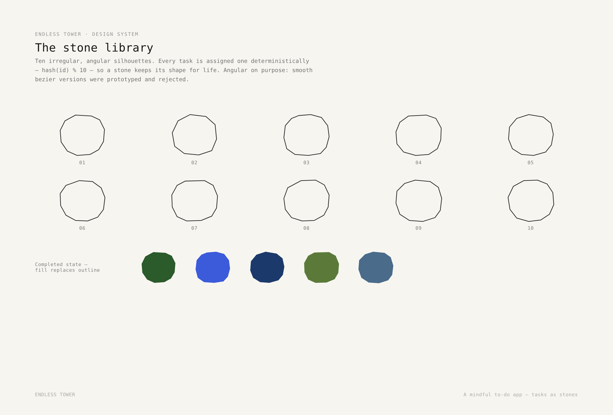

### Color

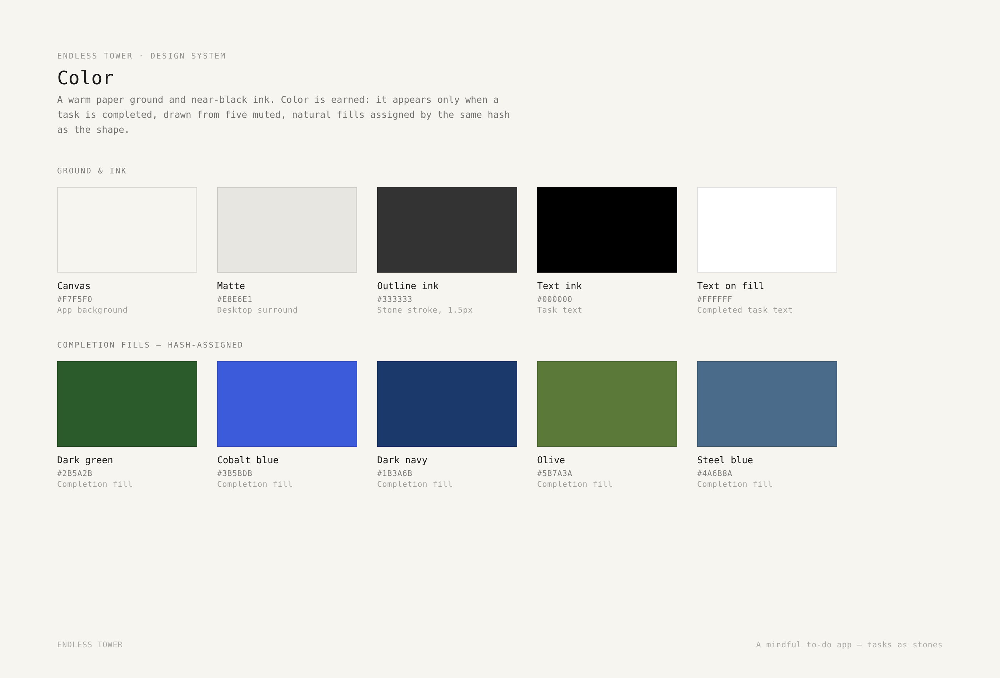

### Typography

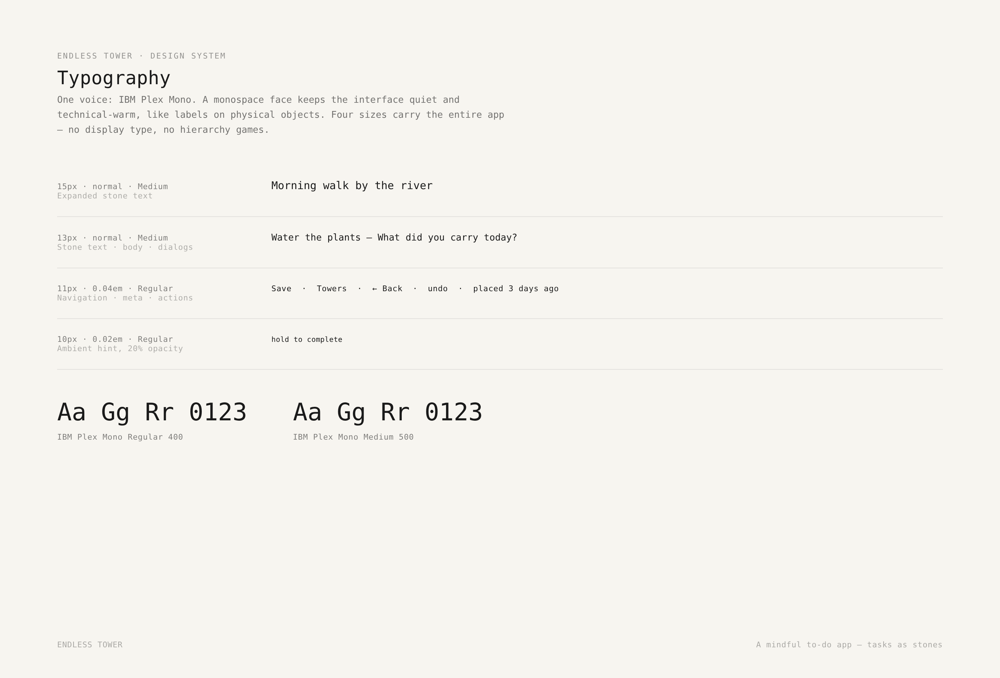

### Interaction & construction

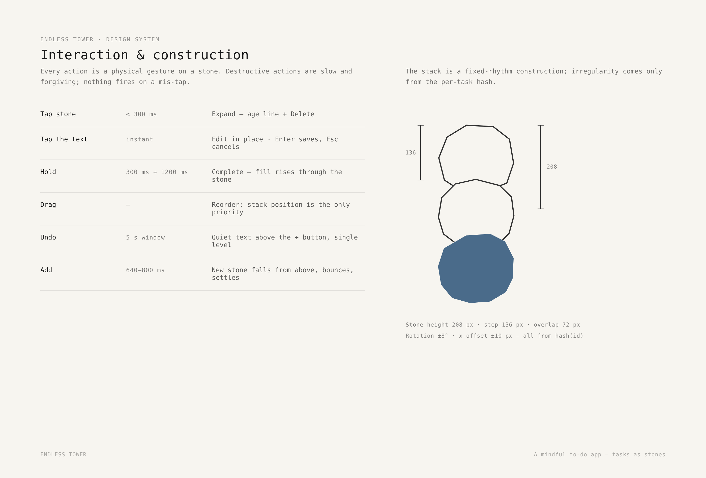

---

## Decisions worth noting

- **Angular over organic.** Smooth bezier stones were prototyped and rejected in testing —
  the angular originals read as more deliberate and less "blobby".
- **No priority field.** An early `priority` property was removed: the stack *is* the
  priority. Drag to reprioritise is literally true.
- **Sinking stones — rejected.** A prototype where completed stones sank into the ground
  was built and killed: completed stones are the reward, and they power the archive's
  colourful miniatures.
- **The archive is honest.** Mini towers reuse each stone's real hash-derived shape and
  colour rather than decorative placeholders.
- **Undo instead of confirmation.** No "Are you sure?" dialogs — destructive actions are
  slow to trigger and quick to reverse.

---

*All screens captured from the live build (Nov 2026). Specimen sheets generated from the
production SVG paths and design tokens in `app/lib/stone-paths.ts`.*
